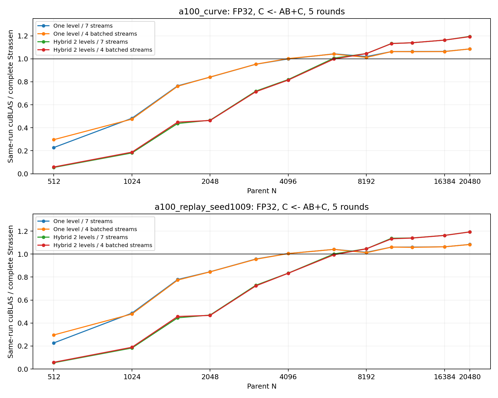
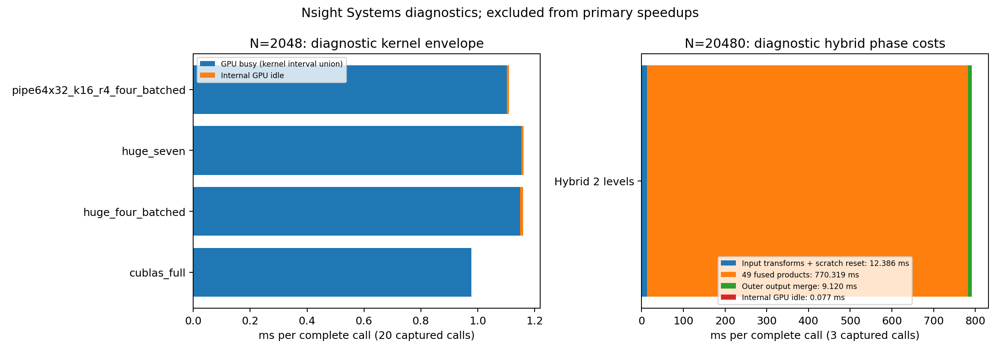

# A100/A800 FP32 Strassen：论文 batching 与混合两层

本报告保留原冻结 Huge/混合两层结果。后续 4×8 列映射已在 A100 达到 N=1536 的独立输入验收，
完整小尺寸结果、负对照和验证见 [primitive 优化报告](../strassen_primitive_20261017/REPORT.md)。

固定实现：`64e2695` 的算术代码；列主序 FP32 `C <- AB+C`，alpha=beta=1。
主表为完整调用的 CUDA event 计时；所有变换、中间输出清零、乘积、合并和跨流依赖均计入。
仅分配、输入生成、流/事件创建排除。禁用 TF32，cuBLAS PEDANTIC，误差阈值不变。

## 原冻结 Huge 配置的 crossover：一层未达标

大尺寸混合两层达到约 1.19×，不代表论文的小尺寸一层 crossover 已复现。
论文在 V100 SXM2 / CUDA 9.1 上报告一层 N=1536、混合两层 N=7680；
本报告是在 A100 PCIe / CUDA 12.2 上验证相对性能，不能据此声称同硬件精确复现。
论文依据见[原文摘要与第 4 节](../../paper/3372419.pdf)。

| 算法 | 论文报告 crossover | A100 首个明确胜出的加密测点 | 数值目标 |
|---|---:|---:|---|
| 一层 | 1536 | 4352 | 未达到 |
| 混合两层 | 7680 | 6656 | 已测点不晚于论文；仍有环境差异 |

A100 的“明确胜出”指两组输入各自五轮 candidate 最慢值低于同批 cuBLAS 最快值；
这是测点描述，不是统计置信区间，也不是所有后续尺寸均胜出的单调阈值。
当前主曲线固定 Huge 七流；论文对策略和块大小择优，两者的配置选择范围尚未对齐。
因此 4352 不能解释为本实现所有分块策略的最佳 crossover。后续重点是 N=1536/2048 的完整一层调用。

## 固定候选与独立复测

固定比较 Huge 七流、四类 batching，以及相应的混合两层。下表使用七流作为共同基线，
不根据复测后的最低值重新选候选。四类 batching 的全部结果见 algorithm_comparison.csv。

| 运行 | N | cuBLAS ms | 一层 ms | 两层 ms | 一层加速比 | 两层加速比 | 两层相对一层耗时下降 |
|---|---:|---:|---:|---:|---:|---:|---:|
| a100_curve | 2048 | 0.976705 | 1.161968 | 2.097429 | 0.8406× | 0.4657× | -80.51% |
| a100_curve | 4096 | 7.305180 | 7.315566 | 8.913564 | 0.9986× | 0.8196× | -21.84% |
| a100_curve | 6144 | 25.135786 | 24.091534 | 24.983040 | 1.0433× | 1.0061× | -3.70% |
| a100_curve | 8192 | 57.344002 | 56.258049 | 54.842113 | 1.0193× | 1.0456× | 2.52% |
| a100_curve | 10240 | 117.669545 | 110.703613 | 103.799805 | 1.0629× | 1.1336× | 6.24% |
| a100_curve | 12288 | 203.295410 | 191.144613 | 178.411865 | 1.0636× | 1.1395× | 6.66% |
| a100_curve | 16384 | 481.553426 | 452.599447 | 414.158488 | 1.0640× | 1.1627× | 8.49% |
| a100_curve | 20480 | 960.639974 | 884.775960 | 803.946533 | 1.0857× | 1.1949× | 9.14% |
| a100_replay_seed1009 | 2048 | 0.984494 | 1.163530 | 2.097271 | 0.8461× | 0.4694× | -80.25% |
| a100_replay_seed1009 | 4096 | 7.467425 | 7.430802 | 8.950784 | 1.0049× | 0.8343× | -20.46% |
| a100_replay_seed1009 | 6144 | 25.408768 | 24.408405 | 25.374336 | 1.0410× | 1.0014× | -3.96% |
| a100_replay_seed1009 | 8192 | 57.936127 | 57.056767 | 55.379456 | 1.0154× | 1.0462× | 2.94% |
| a100_replay_seed1009 | 10240 | 118.231720 | 111.454549 | 103.922007 | 1.0608× | 1.1377× | 6.76% |
| a100_replay_seed1009 | 12288 | 203.504293 | 191.841960 | 178.515279 | 1.0608× | 1.1400× | 6.95% |
| a100_replay_seed1009 | 16384 | 480.871094 | 452.347575 | 413.545817 | 1.0631× | 1.1628× | 8.58% |
| a100_replay_seed1009 | 20480 | 957.859538 | 883.803141 | 802.924235 | 1.0838× | 1.1930× | 9.15% |



## 正确性与可复现性

| 运行 | 输入 seed offset | 计时行 | FP64 校验记录 | 最大 relative L2 |
|---|---:|---:|---:|---:|
| a100_crossover_seed0 | 0 | 255 | 102 | 4.0385834e-06 |
| a100_crossover_seed1009 | 1009 | 255 | 102 | 3.283673e-06 |
| a100_curve | 0 | 300 | 120 | 4.9747042e-06 |
| a100_replay_seed1009 | 1009 | 300 | 120 | 4.7368875e-06 |
| a100_small_seed1009 | 1009 | 150 | 60 | 1.8142765e-06 |
| iter3_signal | 0 | 108 | 72 | 3.1725278e-06 |
| iter4_hybrid_smoke | 0 | 0 | 48 | 8.4914467e-07 |

每个 size/case 检查一次与连续三次累加；N<=128 全量检查，其他尺寸检查含角点的 128 个请求位置。
同一 seed 下的重复记录不代表独立输入。不同 seed offset 的输入及 FP64 参考同步变化。
五轮随机顺序，目标 200 ms，至少三次调用。GPU 不手动锁频，分母只取同批 cuBLAS。
每次构建和复测保留源文件 SHA256、命令、环境、GPU UUID、原始轮次、校验及 telemetry。
当前工作树已继续优化；本表仍来自原固定构建。工作树与归档差异见 current_source_match.json。

## 实现与显存

论文四类 batching 使用三个双乘积 batch 和一个单乘积，由四条流并发执行。
原配对对照则按阶段执行；两者不是同一调度。输出使用原子加，调用流等待全部 worker。
混合两层将外层变换写入紧凑矩阵，七个外层产品依次调用融合一层，共 49 个四分之一乘积。
复现的是论文的混合分层结构；外层变换和工作区调度由本仓库实现，不宣称与论文参考代码逐行一致。
准备 kernel 同时清零每个新的中间输出，merge 在调用流执行，保留原始 C 和重复调用语义。
复用三个半尺寸 scratch 矩阵，额外显存为 `3*N*N` 字节；N=20480 时约 1.172 GiB，
不含原始 A/B/C。各算法阶段的诊断计时见 timeline_comparison.csv。

## 分析边界

Nsight Systems/Compute 的时长不用于主表。时间线的 busy 是 kernel 区间并集，
internal idle 只覆盖首个 kernel 到最后一个 kernel 的内部空隙，不等同于全部调用开销。
小尺寸调度收益、非单调 crossover 和不同 GPU 的结论分别报告；不以 8/7 或 64/49 算术量比作性能硬上界。
A800 只有完整成功的 CSV 出现后才计入结果；排队状态和自动执行日志另存，未运行不代表通过。

复现入口：`scripts/STRASSEN_BATCHING.md`。

## Crossover 加密测点

下表给出每个输入种子下的中位数加速比；四类 batching 及观测耗时范围见 crossover.csv。
范围分离表示本次五轮中 candidate 最慢值仍低于 cuBLAS 最快值，不是统计置信区间。
这些结果只覆盖已测尺寸，不假设尺寸增大时性能单调。

| N | 一层 seed 0 | 一层 seed 1009 | 两层 seed 0 | 两层 seed 1009 |
|---:|---:|---:|---:|---:|
| 4096 | 1.0028× | 0.9999× | 0.8346× | 0.8340× |
| 4352 | 1.0150× | 1.0165× | — | — |
| 4608 | 1.0164× | 1.0190× | 0.8834× | 0.8876× |
| 4864 | 1.0199× | 1.0217× | — | — |
| 5120 | 1.0169× | 1.0188× | 0.9305× | 0.9309× |
| 5632 | 1.0030× | 1.0029× | 0.9798× | 0.9793× |
| 6144 | 1.0339× | 1.0370× | 0.9981× | 0.9990× |
| 6656 | 1.0923× | 1.0907× | 1.1016× | 1.0998× |
| 7168 | 1.0946× | 1.1012× | 1.1053× | 1.1118× |
| 7680 | 1.0342× | 1.0345× | 1.0504× | 1.0496× |
| 8192 | 1.0188× | 1.0176× | 1.0550× | 1.0558× |

## 仪器验证

逐命令退出状态、输入校验、工具日志和源文件验证位于 verification/。
共享内存 racecheck 不替代跨流全局输出的原子/依赖约束。

```json
{
  "memcheck_batched_fp64_checks": 4,
  "memcheck_hybrid_fp64_checks": 4,
  "memcheck_huge_hybrid_fp64_checks": 2,
  "racecheck_hybrid_fp64_checks": 2,
  "ffma_instructions": 37536,
  "tensor_instructions": 0,
  "cublas_tensor_instructions": [
    0.0
  ],
  "timeline_profiles": 5
}
```

| Profile | kernel 数 | 每调用 GPU busy ms | 每调用内部 idle ms |
|---|---:|---:|---:|
| timeline_cublas_full | 20 | 0.977215 | 0.001019 |
| timeline_huge_four_batched_atomic | 80 | 1.149425 | 0.010542 |
| timeline_huge_seven_atomic | 140 | 1.153485 | 0.008176 |
| timeline_hybrid_large | 189 | 791.824677 | 0.077163 |
| timeline_pipe64x32_k16_r4_four_batched_atomic | 80 | 1.103210 | 0.006826 |



## 工具异常与恢复

首个验证流程在 NCU Tensor 计数阶段以 9 退出：无法写入其他用户拥有的 /tmp/nsight-compute-lock。
此前四个 sanitizer 命令和五个时间线采集均成功；全部性能/常规数值数据未重跑或改写。
确认节点没有其他 NCU 采集后，按 [NVIDIA Profiling Guide](https://docs.nvidia.com/nsight-compute/ProfilingGuide/index.html#faq)
使用用户可写的独立 TMPDIR，仅重跑 Tensor 审计并补做 SASS 导出；两项均以 0 退出，汇总分析通过。
原失败证据在 verification/tensor_cublas_initial/ 和 a100_followup.initial.status.json，修复命令另存。

## 结果解读与选择

N=20480 的两组输入中，七流混合两层相对同批 cuBLAS 为 1.1949× / 1.1930×，
相对对应一层的耗时下降为 9.14% / 9.15%。
N=10240、12288、16384、20480 的两层收益均超过本轮 3% 投入门槛，可作为后续大尺寸工作基线。
在较小尺寸应继续区分两层相对 cuBLAS 的收益与两层相对一层的额外收益；工作区开销也需纳入选择。
本报告原冻结候选在 N=2048 仍未超过 cuBLAS；后续列映射结果见前述独立报告。四类 batching 没有在所有尺寸稳定优于七流，因此保留显式选择。
本轮不新增自动 GEMM 回退，不以 post-hoc 最低值替换预先固定的七流对照。
一层在 N=4096 附近持平，N=4352 的两组加密测点中位数开始超过 cuBLAS；N=5632 仍接近持平。
两层在加密测点 N=6144 附近持平，N=6656 的两组中位数明确超过 cuBLAS。这里只描述测点，不保证未测尺寸。
N=2048 七流时间线内部 GPU 空隙约 0.008 ms，小于与 cuBLAS 约 0.185 ms 的完整调用差距；
目前没有足够证据优先投入 Graph。时间线并非完整调用的性能下界，也不证明 Graph 在其他场景无用。
