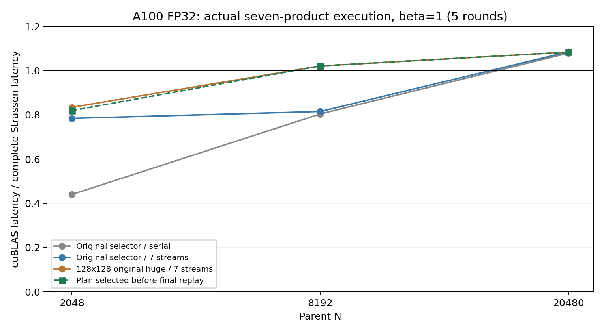
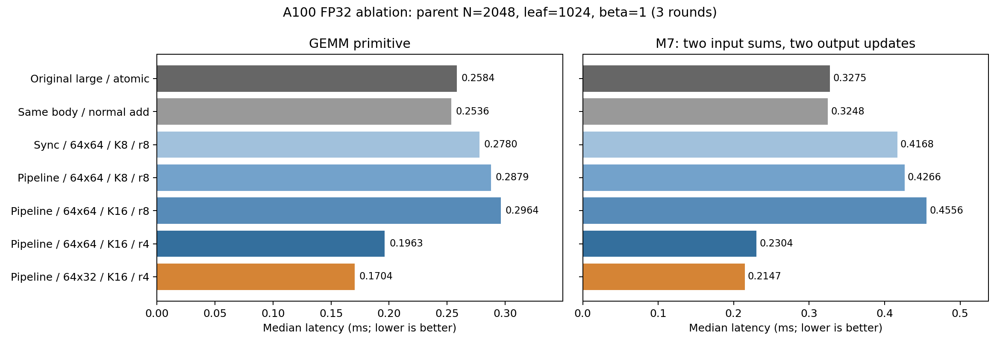

# A100 上的一层 FP32 Strassen：分块对照与端到端验证

已完成 N=2048、叶子 1024 的计算循环、分块、输出更新对照，并接入真正的七乘积
Strassen。大尺寸成本余量可以转化为端到端收益；N=2048 仍慢于同批 cuBLAS。
以下数据来自同一块 NVIDIA A100 80GB PCIe、CUDA 12.2（nvcc 12.2.140）、
cuBLAS 120205。操作均为列主序 FP32 `C <- AB+C`，alpha=beta=1。

**五轮最终复测。** 下表列出本轮最终候选中的最低中位数，属于复测后的描述性比较。
加速比定义为同批 cuBLAS 完整 N×N GEMM 时间除以完整 Strassen 时间。

| N | 叶子尺寸 | cuBLAS ms | 最终候选中最快路径 | Strassen ms | 加速比 |
|---:|---:|---:|---|---:|---:|
| 2048 | 1024 | 0.978687 | `huge_seven_atomic` | 1.173235 | 0.8342× |
| 8192 | 4096 | 57.929214 | `huge_paired_atomic` | 56.527103 | 1.0248× |
| 20480 | 10240 | 960.525635 | `huge_paired_atomic` | 885.076986 | 1.0852× |

小尺寸排名在信号轮与最终复测之间发生变化。信号轮的新 `64x32` 七流为 1.154094 ms，
最终复测为 1.194171 ms；
原版 `huge` 七流最终为 1.173235 ms。
两者均未超过 cuBLAS，不能把单个 primitive 的约 1.52× 收益写成完整 Strassen 的收益。
本轮最稳妥的已测实现基线是 `Huge/SevenAtomic`；小尺寸的新分块保留为研究候选。

为保留选择过程，以下是迭代 2 提交中、最终复测前已经固定的方案。
该方案在 N=2048 的最终表现并非所有复测候选中的最好值。

| N | 预先选定的路径 | 中位数 ms | 加速比 | 轮次 CV |
|---:|---|---:|---:|---:|
| 2048 | `pipe64x32_k16_r4_seven_atomic` | 1.194171 | 0.8196× | 0.999% |
| 8192 | `huge_seven_atomic` | 56.723457 | 1.0213× | 0.250% |
| 20480 | `huge_seven_atomic` | 886.204102 | 1.0839× | 0.219% |

**成本余量如何解释。** 以下为迭代 1 同批 cuBLAS 的诊断代理。叶子使用父矩阵
leading dimension=N。`7×leaf` 假设七个乘积都能保持普通叶子 GEMM 的速度，
尚未计入输入和、多个输出更新、调度及并发资源竞争，既不是完整调用时间，也不是硬件下界。

| N | full GEMM ms | leaf GEMM ms | 7×leaf ms | full/(7×leaf) |
|---:|---:|---:|---:|---:|
| 2048 | 0.976608 | 0.128814 | 0.901699 | 1.0831× |
| 8192 | 57.343999 | 7.377774 | 51.644417 | 1.1104× |
| 20480 | 959.882243 | 118.104065 | 826.728455 | 1.1611× |

最终完整调用显示：大尺寸的这类余量有一部分兑现；N=2048 的普通叶子代理余量
不足以弥补当前融合 primitive 相对 cuBLAS leaf 的差距。判断依据是前面的完整计时表。

**1024 叶子的受控对照。** 以下全部取自迭代 1 的三轮诊断数据。
`normal add` 保留 beta=1，读取旧 C 后累加。M7 融合两个输入和、一个乘积、两个输出更新。

| 对照 | GEMM primitive ms | M7 primitive ms |
|---|---:|---:|
| Original large / atomic | 0.258395 | 0.327541 |
| Same body / normal add | 0.253569 | 0.324752 |
| Sync / 64x64 / K8 / r8 | 0.277965 | 0.416759 |
| Pipeline / 64x64 / K8 / r8 | 0.287876 | 0.426600 |
| Pipeline / 64x64 / K16 / r8 | 0.296358 | 0.455633 |
| Pipeline / 64x64 / K16 / r4 | 0.196294 | 0.230441 |
| Pipeline / 64x32 / K16 / r4 | 0.170362 | 0.214696 |

同计算主体只改输出更新：GEMM 改善约 1.9%，M7 约 0.9%。单独引入双缓冲预取、
增大 BK，没有改善这组实现。主要收益来自较小的线程累加器与 `64x32` CTA 分块：
相对原版 large，GEMM 为 1.517×、M7 为 1.526×。
这些数据支持优先改线程分工和网格规模；它们没有证明预取循环在所有布局上无用。

原版 large 在该尺寸只有 256 个 CTA、每块 64 线程，共 512 个 warp。
新候选为 512 个 CTA、每块 128 线程，共 2048 个 warp。Nsight 的实际资源数据如下：

| 路径 | 寄存器/线程 | 理论占用率 % | 实测占用率 % | Waves/SM |
|---|---:|---:|---:|---:|
| original_large | 113 | 25 | 6.60 | 0.30 |
| pipe64x32_k16_r4 | 56 | 56.25 | 23.47 | 0.53 |

原版低实测占用率同时受网格不足影响，不能全部归因于寄存器数量。
原始 Nsight CSV 还报告原版的全局访问额外 sector 占 54%、共享内存额外 wavefront 占 39%。
新候选对应为 6% 与 3%。这里采集的是单个 GEMM primitive，不代表七流重叠时的指标。
这些是诊断指标；NCU 采集的时长没有用于主表性能计算。

**大尺寸回归。** `64x32` 候选不能替换所有尺寸。迭代 1 的 N=20480 上，
其 GEMM/M7 为 165.764/200.717 ms，原版 huge 为 119.883/130.526 ms。
迭代 2 的完整七流路径也从 huge 的 882.382 ms 退化到该候选的 1328.033 ms。
小分块增加并行度，同时降低块内数据复用；实测说明必须保留尺寸相关的选择。
在 N=8192，把叶子 4096 从原选择器的 large 改成 huge，完整七流从约 70.860 ms
降到 56.465 ms（信号轮）。原选择器在 N=20480 已使用 huge。

**调度对照。** 全部路径计算同一组七个乘积，没有常规 GEMM 回退。
串行原子、串行普通累加、七流原子、按依赖分阶段普通累加均已测。
额外的四次启动方案依次执行 `(M1,M2)`、`(M3,M4)`、`(M5,M6)`、M7；
每对的有效输出互不重叠，普通累加安全。它在小尺寸未超过七流调度，
N=20480 的 huge 配对路径也仅接近七流。原始负面结果保存在 CSV 中。

**计时与正确性。** CUDA events 覆盖重复的完整调用，包括变换、乘积、输出更新、
跨流等待和调用流汇合。预建流/事件，A/B/C 输入准备在计时前；算法不清零 C。
cuBLAS 使用 `CUBLAS_PEDANTIC_MATH`、禁用原子，环境设置 `NVIDIA_TF32_OVERRIDE=0`。
所有候选先 warmup，再随机化每轮顺序。最终五轮、每批目标 200 ms、至少三次调用。
未手动锁频；必须使用本批 cuBLAS 分母，不能拼接上一轮硬件/时钟状态的数据。

最终常规复测共 48 条 FP64 检查记录，覆盖一次及连续三次累加；
最大抽样 relative L2 为 3.16920876e-06，相对 L2 上限 3e-5、scaled max 上限 1e-4 均未改动。
小尺寸 N<=128 全量验证，其他尺寸请求 128 个含角点的位置并去重；primitive 还查未写象限。
额外检查包括普通累加配对的 N=120/2056（部分 tile、K 尾部）以及 huge 配对 N=256。
memcheck 和共享内存 racecheck 均通过；racecheck 检查共享内存竞争，跨流全局输出安全由
原子更新或显式输出依赖保障，并由完整结果重复累加检查共同验证。
可执行文件中共 37536 条静态 FFMA 指令、
0 条 Tensor 指令；本批 cuBLAS 的动态 Tensor 指令数为
0。

六个仪器命令均以 0 退出。初次汇总脚本把 `HFMA2.MMA` 的 `.MMA` 修饰符误认成
Tensor 指令，因而汇总阶段以 1 退出。已改为解析 SASS 指令基名，并复用原始仪器日志
重新审计通过；性能与数值测试没有重跑或改写。初次失败日志保存在
`verification_console.log`，修正后的审计为 `verification/audit.status.json` 与 `summary.json`。

| 阶段 | 原始计时行 | FP64 校验记录 | 结果 |
|---|---:|---:|---|
| `iter1_ablation` | 360 | 240 | PASS |
| `endtoend_screen` | 81 | 54 | PASS |
| `iter2_endtoend` | 108 | 72 | PASS |
| `final_small` | 60 | 24 | PASS |
| `final_large` | 60 | 24 | PASS |

这些校验记录包含对同一确定性输入的重复，不代表独立随机样本数量。
结果覆盖本次 A100 的三个测点；A800、V100、论文全部尺寸曲线和两层混合版本尚未测。
本轮没有定位精确的 crossover，也不把 8/7 的算术量比当作所有有限尺寸的性能上界。

**代码与复现。** 使用说明、操作边界和命令见 [STRASSEN_ONELEVEL.md](../../scripts/STRASSEN_ONELEVEL.md)。
实现为 `solution/strassen_cuda/engine.cuh`，最终复测使用迭代 2 的不可变构建。
当前 engine.cuh, huge_pair.cuh, large_control.cuh, simt.cuh 与该构建的归档文件逐字节一致，见 [current_source_match.json](current_source_match.json)。
原始头文件、构建命令、源文件 SHA256、GPU UUID、环境、轮次、校验和 telemetry 都已归档。

- [最终全部候选表](final_comparison.csv)、[预先固定方案表](recommended.csv)
- [分块对照表](ablation_comparison.csv)、[编译资源表](compiler_resources.csv)、[Nsight 资源对照](profile_comparison.csv)
- [小尺寸最终轮次](final_small/results.rounds.csv)、[大尺寸最终轮次](final_large/results.rounds.csv)
- [仪器检查结果](verification/summary.json)、[分块图 PDF](ablation.pdf)、[端到端图 PDF](endtoend.pdf)
