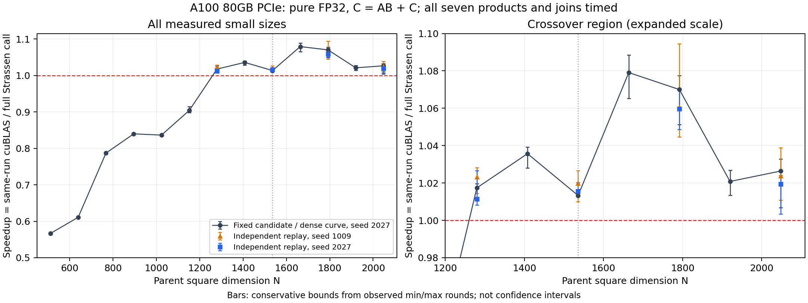

# A100 小尺寸融合 Strassen primitive 优化

**当前验收：A100 上 N=1536 已超过同批 cuBLAS。**

最终固定配置为 `column_tile64_k16_r4x8 / four_batched_atomic`，选择与 SHA256 见 selection_batched_column.json。
两组新输入各七轮、每轮目标 300 ms；两组 N=1536 的 candidate 最慢轮仍快于 cuBLAS 最快轮。
此结论针对本机 A100 / CUDA12.2 / cuBLAS12.2.5 的相对性能；原论文 V100 SXM2 / CUDA9.1 的绝对时长未作数值复刻。

| 独立输入 offset | N | Strassen ms | 同批 cuBLAS ms | 加速比 |
|---:|---:|---:|---:|---:|
| 1009 | 1280 | 0.252548 | 0.258400 | 1.0232× |
| 1009 | 1536 | 0.428828 | 0.437367 | 1.0199× |
| 1009 | 1792 | 0.656334 | 0.695982 | 1.0604× |
| 1009 | 2048 | 0.970222 | 0.993407 | 1.0239× |
| 2027 | 1280 | 0.254717 | 0.257629 | 1.0114× |
| 2027 | 1536 | 0.429042 | 0.435721 | 1.0156× |
| 2027 | 1792 | 0.657766 | 0.696969 | 1.0596× |
| 2027 | 2048 | 0.969200 | 0.987992 | 1.0194× |

memcheck：N=120/128/1536/2056；racecheck：N=120/128；均零错误/零 hazard。
部分 tile 回退保留融合七乘积，不以普通 GEMM 替代。A800 固定候选验证作业为 108136，排队状态不视为实测。

验收目标仍是一层完整调用在 N=1536 超过同批纯 FP32 cuBLAS；未达标不得以大尺寸收益替代。
操作 C←AB+C，alpha=beta=1，cuBLAS PEDANTIC、禁用 TF32、现有误差阈值保持不变。
主计时覆盖全部七乘积、融合输入和/输出更新及跨流依赖；排除分配、输入生成与流创建。

## 四类 primitive 的测量

详细寄存器、CTA、共享内存、理论与隔离 occupancy、加载/原子 sector 在 primitive_counters.csv。
NCU kernel replay 会串行重放 kernel，这些 occupancy 和时长只用于解释隔离 primitive，
不能当成并发时的占用率或主性能结论。Var1/Var2/Var3 各代表两乘积，Var0 代表 M7。
four_batched_atomic 的前三个 launch 各覆盖两乘积，grid/sector 为该对产品的合计；
CSV 的 batched_pair 和 launch_id 标明采集单位，不能与单产品计数直接作倍数结论。

| 采集 | leaf | 变体 | 寄存器/线程 | CTA | 共享写 bank conflicts | reduction sectors |
|---|---:|---|---:|---:|---:|---:|
| profile_baseline_detail | 768 | Var3: A2 B1 C2 | 48 | 144 | 221184 | 589824 |
| profile_baseline_detail | 768 | Var1: A2 B2 C1 | 48 | 144 | 221184 | 294912 |
| profile_baseline_detail | 768 | Var2: A1 B2 C2 | 47 | 144 | 221184 | 589824 |
| profile_baseline_detail | 768 | Var0: A2 B2 C2 | 48 | 144 | 221184 | 589824 |
| profile_baseline_detail | 1024 | Var3: A2 B1 C2 | 48 | 256 | 524288 | 1.04858e+06 |
| profile_baseline_detail | 1024 | Var1: A2 B2 C1 | 48 | 256 | 524288 | 524288 |
| profile_baseline_detail | 1024 | Var2: A1 B2 C2 | 47 | 256 | 524288 | 1.04858e+06 |
| profile_baseline_detail | 1024 | Var0: A2 B2 C2 | 48 | 256 | 524288 | 1.04858e+06 |
| profile_coalesced | 768 | Var3: A2 B1 C2 | 55 | 144 | 0 | 147456 |
| profile_coalesced | 768 | Var1: A2 B2 C1 | 51 | 144 | 0 | 73728 |
| profile_coalesced | 768 | Var2: A1 B2 C2 | 51 | 144 | 0 | 147456 |
| profile_coalesced | 768 | Var0: A2 B2 C2 | 51 | 144 | 0 | 147456 |
| profile_coalesced | 1024 | Var3: A2 B1 C2 | 55 | 256 | 0 | 262144 |
| profile_coalesced | 1024 | Var1: A2 B2 C1 | 51 | 256 | 0 | 131072 |
| profile_coalesced | 1024 | Var2: A1 B2 C2 | 51 | 256 | 0 | 262144 |
| profile_coalesced | 1024 | Var0: A2 B2 C2 | 51 | 256 | 0 | 262144 |
| profile_column | 768 | Var3: A2 B1 C2 | 107 | 144 | 0 | 147456 |
| profile_column | 768 | Var1: A2 B2 C1 | 119 | 144 | 0 | 73728 |
| profile_column | 768 | Var2: A1 B2 C2 | 107 | 144 | 0 | 147456 |
| profile_column | 768 | Var0: A2 B2 C2 | 119 | 144 | 0 | 147456 |
| profile_column | 1024 | Var3: A2 B1 C2 | 107 | 256 | 0 | 262144 |
| profile_column | 1024 | Var1: A2 B2 C1 | 119 | 256 | 0 | 131072 |
| profile_column | 1024 | Var2: A1 B2 C2 | 107 | 256 | 0 | 262144 |
| profile_column | 1024 | Var0: A2 B2 C2 | 119 | 256 | 0 | 262144 |
| profile_exact | 768 | Var3: A2 B1 C2 | 63 | 144 | 0 | 147456 |
| profile_exact | 768 | Var1: A2 B2 C1 | 63 | 144 | 0 | 73728 |
| profile_exact | 768 | Var2: A1 B2 C2 | 63 | 144 | 0 | 147456 |
| profile_exact | 768 | Var0: A2 B2 C2 | 63 | 144 | 0 | 147456 |
| profile_exact | 1024 | Var3: A2 B1 C2 | 63 | 256 | 0 | 262144 |
| profile_exact | 1024 | Var1: A2 B2 C1 | 63 | 256 | 0 | 131072 |
| profile_exact | 1024 | Var2: A1 B2 C2 | 63 | 256 | 0 | 262144 |
| profile_exact | 1024 | Var0: A2 B2 C2 | 63 | 256 | 0 | 262144 |
| profile_selected_batched | 768 | Var3: A2 B1 C2 | 111 | 288 | 0 | 294912 |
| profile_selected_batched | 768 | Var1: A2 B2 C1 | 119 | 288 | 0 | 147456 |
| profile_selected_batched | 768 | Var2: A1 B2 C2 | 111 | 288 | 0 | 294912 |
| profile_selected_batched | 768 | Var0: A2 B2 C2 | 119 | 144 | 0 | 147456 |
| profile_selected_batched | 1024 | Var3: A2 B1 C2 | 111 | 512 | 0 | 524288 |
| profile_selected_batched | 1024 | Var1: A2 B2 C1 | 119 | 512 | 0 | 262144 |
| profile_selected_batched | 1024 | Var2: A1 B2 C2 | 111 | 512 | 0 | 524288 |
| profile_selected_batched | 1024 | Var0: A2 B2 C2 | 119 | 256 | 0 | 262144 |
| profile_sliced4 | 768 | Var3: A2 B1 C2 | 104 | 288 | 73728 | 147456 |
| profile_sliced4 | 768 | Var1: A2 B2 C1 | 109 | 288 | 73728 | 73728 |
| profile_sliced4 | 768 | Var2: A1 B2 C2 | 109 | 288 | 73728 | 147456 |
| profile_sliced4 | 768 | Var0: A2 B2 C2 | 107 | 288 | 73728 | 147456 |
| profile_sliced4 | 1024 | Var3: A2 B1 C2 | 104 | 512 | 162284 | 262144 |
| profile_sliced4 | 1024 | Var1: A2 B2 C1 | 109 | 512 | 158124 | 131072 |
| profile_sliced4 | 1024 | Var2: A1 B2 C2 | 109 | 512 | 178410 | 262144 |
| profile_sliced4 | 1024 | Var0: A2 B2 C2 | 107 | 512 | 152298 | 262144 |
| profile_swizzle | 768 | Var3: A2 B1 C2 | 62 | 144 | 0 | 589824 |
| profile_swizzle | 768 | Var1: A2 B2 C1 | 62 | 144 | 0 | 294912 |
| profile_swizzle | 768 | Var2: A1 B2 C2 | 62 | 144 | 0 | 589824 |
| profile_swizzle | 768 | Var0: A2 B2 C2 | 62 | 144 | 0 | 589824 |
| profile_swizzle | 1024 | Var3: A2 B1 C2 | 62 | 256 | 0 | 1.04858e+06 |
| profile_swizzle | 1024 | Var1: A2 B2 C1 | 62 | 256 | 0 | 524288 |
| profile_swizzle | 1024 | Var2: A1 B2 C2 | 62 | 256 | 0 | 1.04858e+06 |
| profile_swizzle | 1024 | Var0: A2 B2 C2 | 62 | 256 | 0 | 1.04858e+06 |

隔离 atomic/ordinary-add 受控计时见 atomic_controls.csv；仅切换同一计算主体的输出更新。
普通加的隔离优势较小，不能直接推导七流并发时原子竞争为零。

## 完整七流并发的计数器

使用 NCU range replay，10 次完整调用为一个范围；保持并发，不按 kernel 串行重放。
cache-control none、clock-control none 与普通测量保持相同策略；profiler 时长不作为主计时。
SM throughput 是该指标定义的 SM 吞吐率，并非单独的 FFMA 利用率，也不是性能下界。

| N | 配置 | active warp occupancy | SM throughput | L1 sector hit rate | L2 sector hit rate |
|---:|---|---:|---:|---:|---:|
| 1536 | cublas_full | 23.92% | 83.05% | 0.56% | 95.62% |
| 1536 | deferred_exact_swizzle_coalesced64_k16_r4_seven_atomic | 43.02% | 72.40% | 0.27% | 96.12% |
| 1536 | pipe64_k16_r4_seven_atomic | 51.50% | 70.11% | 0.62% | 96.66% |
| 2048 | cublas_full | 18.52% | 87.67% | 0.42% | 89.13% |
| 2048 | deferred_exact_swizzle_coalesced64_k16_r4_seven_atomic | 46.06% | 81.32% | 0.07% | 90.39% |
| 2048 | pipe64_k16_r4_seven_atomic | 56.35% | 75.97% | 0.32% | 90.95% |

并发 occupancy 高于 cuBLAS 并未带来更短调用；不以提高 occupancy 本身作为优化验收。

## 完整七乘积调用

每个候选保留同批 cuBLAS，五轮随机顺序、每轮目标 200 ms。下表不作跨运行绝对时长比较。
全部负结果见 complete_calls.csv；仅此表描述每轮 N=1536 的候选中位数最佳值，属于搜索结果，
不能代替预先固定候选的独立输入复测。

| 运行 | N=1536 最快配置 | 一层 ms | 同批 cuBLAS ms | 加速比 |
|---|---|---:|---:|---:|
| holdout_batched_seed1009 | column_tile64_k16_r4x8_four_batched_atomic | 0.428828 | 0.437367 | 1.0199× |
| holdout_batched_seed2027 | column_tile64_k16_r4x8_four_batched_atomic | 0.429042 | 0.435721 | 1.0156× |
| holdout_column_seed1009 | column_tile64_k16_r4x8_seven_atomic | 0.434320 | 0.431633 | 0.9938× |
| holdout_seed1009 | deferred_exact_swizzle_coalesced64_k16_r4_seven_atomic | 0.464700 | 0.431244 | 0.9280× |
| iter10_sliced | deferred_exact_swizzle_coalesced64_k16_r4_seven_atomic | 0.463840 | 0.431209 | 0.9297× |
| iter11_striped | deferred_exact_swizzle_coalesced64_k16_r4_seven_atomic | 0.463952 | 0.432578 | 0.9324× |
| iter12_cache | cg_deferred_exact_swizzle_coalesced64_k16_r4_seven_atomic | 0.465767 | 0.433398 | 0.9305× |
| iter13_batched | deferred_exact_swizzle_coalesced64_k16_r4_four_batched_atomic | 0.461398 | 0.430288 | 0.9326× |
| iter14_striped_tiles | deferred_exact_swizzle_coalesced64_k16_r4_seven_atomic | 0.465753 | 0.431013 | 0.9254× |
| iter15_register_stages | register_stage64_k16_r4x8_seven_atomic | 0.435568 | 0.434181 | 0.9968× |
| iter16_column_resources | column_tile64_k16_r4x8_four_batched_atomic | 0.427133 | 0.431312 | 1.0098× |
| iter5_swizzle | swizzle64_k16_r4_seven_atomic | 0.499919 | 0.435571 | 0.8713× |
| iter6_coalesced | swizzle_coalesced64_k16_r4_seven_atomic | 0.484021 | 0.431906 | 0.8923× |
| iter7_balance | swizzle_coalesced64_k16_r4_seven_atomic | 0.482209 | 0.431685 | 0.8952× |
| iter8_exact | exact_swizzle_coalesced64_k16_r4_seven_atomic | 0.469808 | 0.432762 | 0.9211× |
| iter9_deferred | deferred_exact_swizzle_coalesced64_k16_r4_seven_atomic | 0.464734 | 0.431229 | 0.9279× |
| selected_curve_seed2027 | column_tile64_k16_r4x8_four_batched_atomic | 0.429425 | 0.435140 | 1.0133× |

## 并发完整调用中的 warp 停顿

NCU range replay、每范围 10 次完整调用。停顿比例以活跃 warp 周期为分母；
不同配置的比例不能直接换算为可节省的总调用时间。

| N | 配置 | short scoreboard | long scoreboard | MIO throttle | barrier |
|---:|---|---:|---:|---:|---:|
| 1536 | cublas_full | 2.47% | 7.74% | 2.21% | 4.82% |
| 1536 | deferred_exact_swizzle_coalesced64_k16_r4_four_batched_atomic | 12.87% | 3.81% | 8.08% | 8.73% |
| 1536 | deferred_exact_swizzle_coalesced64_k16_r4_seven_atomic | 13.12% | 3.75% | 7.61% | 8.64% |
| 2048 | cublas_full | 0.15% | 1.52% | 0.06% | 1.51% |
| 2048 | deferred_exact_swizzle_coalesced64_k16_r4_four_batched_atomic | 12.45% | 4.10% | 7.62% | 8.66% |
| 2048 | deferred_exact_swizzle_coalesced64_k16_r4_seven_atomic | 12.49% | 3.89% | 7.58% | 8.78% |
| 1536 | column_tile64_k16_r4x8_four_batched_atomic | 3.98% | 3.33% | 2.30% | 4.98% |
| 1536 | column_tile64_k16_r4x8_seven_atomic | 3.94% | 3.16% | 2.32% | 4.78% |
| 1536 | cublas_full | 2.47% | 7.75% | 2.21% | 4.82% |
| 2048 | column_tile64_k16_r4x8_four_batched_atomic | 4.21% | 3.45% | 2.43% | 5.67% |
| 2048 | column_tile64_k16_r4x8_seven_atomic | 4.16% | 3.15% | 2.44% | 5.58% |
| 2048 | cublas_full | 0.15% | 1.54% | 0.06% | 1.47% |

由此把 shared 到寄存器的预取和依赖隐藏作为后续实验方向；比例差并不证明物理下界。
初次采集的 SASS FFMA 指标不支持 range replay，错误保留在 stall_profiles_initial/；
移除不支持项后六个范围采集成功，主性能计时未修改。

## 第 9 轮冻结候选的独立复测：该候选未达标

选择来自 iteration 9，第二组输入使用同一配置；并非在第二组输入重新择优。
候选为 `deferred_exact_swizzle_coalesced64_k16_r4_seven_atomic`。

| N | 一层 ms | 同批 cuBLAS ms | 加速比 | 持平还需降时 |
|---:|---:|---:|---:|---:|
| 1280 | 0.274583 | 0.257530 | 0.9379× | 6.21% |
| 1536 | 0.464700 | 0.431244 | 0.9280× | 7.20% |
| 1792 | 0.716710 | 0.694492 | 0.9690× | 3.10% |
| 2048 | 1.065794 | 0.995516 | 0.9341× | 6.59% |

## 4×8 列映射的冻结独立输入复测

依据 iteration 15 搜索结果固定 column_tile64_k16_r4x8；
独立输入 seed offset=1009，选择原因和二进制 SHA256 见 selection_column.json。

| N | 一层 ms | 同批 cuBLAS ms | 加速比 |
|---:|---:|---:|---:|
| 1280 | 0.262423 | 0.258071 | 0.9834× |
| 1536 | 0.434320 | 0.431633 | 0.9938× |
| 1792 | 0.655433 | 0.693075 | 1.0574× |
| 2048 | 0.963643 | 0.989009 | 1.0263× |

## 冻结候选的加密尺寸曲线

offset2027，七轮×200ms。首个胜出的采样点为 N=1280，前一点 N=1152 仍落后；
两点之间尚未采样；不据此声称精确转折位置、所有整数尺寸或所有更大尺寸均胜出。

| N | Strassen ms | 同批 cuBLAS ms | 加速比 |
|---:|---:|---:|---:|
| 512 | 0.049940 | 0.028300 | 0.5667× |
| 640 | 0.062761 | 0.038342 | 0.6109× |
| 768 | 0.080795 | 0.063583 | 0.7870× |
| 896 | 0.112979 | 0.094869 | 0.8397× |
| 1024 | 0.153941 | 0.128747 | 0.8363× |
| 1152 | 0.201618 | 0.182237 | 0.9039× |
| 1280 | 0.252978 | 0.257376 | 1.0174× |
| 1408 | 0.319439 | 0.330835 | 1.0357× |
| 1536 | 0.429425 | 0.435140 | 1.0133× |
| 1664 | 0.517597 | 0.558532 | 1.0791× |
| 1792 | 0.651087 | 0.696660 | 1.0700× |
| 1920 | 0.806617 | 0.823412 | 1.0208× |
| 2048 | 0.963169 | 0.988586 | 1.0264× |

## 大尺寸回归：小尺寸配置不能覆盖全部尺寸

保留全部七流/四类 batching 结果，不把 column 配置的退化隐藏为自动普通 GEMM 回退。

| N | 配置 | Strassen ms | 同批 cuBLAS ms | 加速比 |
|---:|---|---:|---:|---:|
| 8192 | column_tile64_k16_r4x8_four_batched_atomic | 64.0479 | 57.5060 | 0.8979× |
| 8192 | column_tile64_k16_r4x8_seven_atomic | 63.3393 | 57.5060 | 0.9079× |
| 8192 | huge_four_batched_atomic | 56.5998 | 57.5060 | 1.0160× |
| 8192 | huge_seven_atomic | 56.3203 | 57.5060 | 1.0211× |
| 20480 | column_tile64_k16_r4x8_four_batched_atomic | 1022.3950 | 951.3462 | 0.9305× |
| 20480 | column_tile64_k16_r4x8_seven_atomic | 1024.6533 | 951.3462 | 0.9285× |
| 20480 | huge_four_batched_atomic | 882.7259 | 951.3462 | 1.0777× |
| 20480 | huge_seven_atomic | 883.8352 | 951.3462 | 1.0764× |

小尺寸使用 column、较大尺寸保留 Huge/已有混合两层为不同固定配置；
该小尺寸优化不替代旧的大尺寸混合两层报告，也不据此宣称整个尺寸域有单调 crossover。

## 实现方向与证据边界

- XOR swizzle 消除测得的共享 B 写 bank 冲突，并保留 float4 对齐；寄存器代价逐类报告。
- 输出整理复用 shared packing 存储，不增加全局中间矩阵；保留全部原子加和两次阶段间同步。
- 精确分块路径去除无用的边界分支，仅在 leaf%64==0 时启用；部分 tile 仍走 masked 融合路径。
- 寄存器 8×4 与 K=8/32 的退化保留，不能由更大线程累加器推断完整调用更快。
- 预取输入和的时序优化需要实际 SASS/计数器与完整调用验证，不以源码中存在双缓冲作为成功证据。

memcheck 覆盖 N=120/128/1536/2056，含精确分块与 masked 回退；共享 racecheck 覆盖 N=120/128。
验证对象和源版本以 verification/ 的来源记录为准，不能自动扩展到之后新增的实验内核。
初次 range replay 因旧版 NCU 不支持 profile-from-start 参数而失败，保留在 range_profiles_initial/；
去除该参数、按默认 Profiler API 范围重试后六次采集成功；未改写主性能数据。

资料：[NVIDIA CUTLASS software pipelining](https://github.com/NVIDIA/cutlass/blob/main/media/docs/cpp/efficient_gemm.md)，
[Nsight Compute kernel/range replay 的差别](https://docs.nvidia.com/nsight-compute/ProfilingGuide/index.html#range-replay)。
环境、二进制来源、归档源码 SHA256、命令、每轮原始值、FP64 校验和 telemetry 均在各运行目录。
